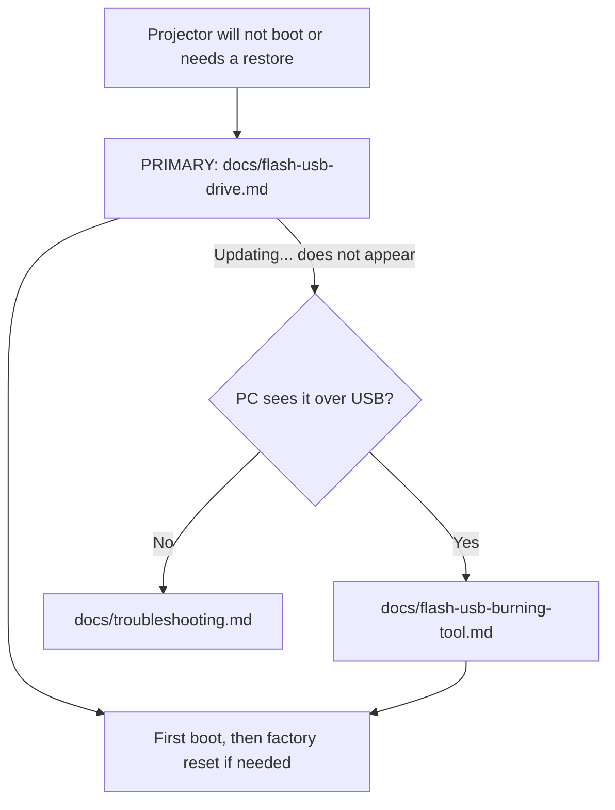

# 📽️ E-Gate Atom 3X: firmware restore kit

> Unofficial community kit for restoring the **E GATE Atom 3X** (model **E04i32**) Android projector from a boot loop or bad state. **Flashing erases the device. Follow the checks first. Not affiliated with E-Gate / Egate Infotel.**

## ⚡ At a glance

| Item | Value |
|---|---|
| Product | E GATE Atom 3X, model E04i32 (Egate Infotel Pvt Ltd, India) |
| SoC | Amlogic T950S |
| Board / device | `t950s_be311`, build board `ljs5` (`ap201`) |
| OS | Android 13 (`TQ2A.230405.003.E1`, userdebug, test-keys) |
| **Download file** | `aml_upgrade_package.img.7z` (941,518,670 bytes, 898 MiB) |
| 7z SHA256 | `0b7d127a8621d241dcf18f77ffd9a99f4e711a3d3b89728a94e7bb808b496c62` |
| Inside the archive | `aml_upgrade_package.img` (2,233,291,152 bytes, about 2.08 GiB) |
| Image MD5 | `3efa401f3fe13a5e6b7fddd54ea299f3` |
| Image SHA256 | `111cec74c27d38b46a0d80c500d15dd979f2eccccce583e3e5003b3df6dd854d` |

## 🗺️ Which route do I take?



## 📦 Repository layout

```text
egate-atom-3x-firmware/
├── README.md                      this file
├── firmware/
│   ├── aml_upgrade_package.img.7z firmware archive (stored with Git LFS)
│   ├── aml_sdc_burn.ini           SD-card burn script from the package
│   ├── md5.txt                    checksum shipped with the package
│   └── SHA256SUMS.txt             SHA256 of the .7z and the extracted .img
└── docs/
    ├── device-info.md             what the device reports about itself
    ├── flash-usb-drive.md         PRIMARY method: pendrive + power button
    ├── flash-usb-burning-tool.md  fallback: PC route
    └── troubleshooting.md         boot loop notes and what not to disable
```

> The firmware `aml_upgrade_package.img.7z` (898 MiB) is stored with **Git LFS**, because GitHub blocks normal git files over 100 MB. A Release copy is kept as a backup. See [Getting the firmware](#-getting-the-firmware).

## 📥 Getting the firmware

| Where | How | Notes |
|---|---|---|
| **Git LFS** (in this repo) | `git lfs install` then `git clone https://github.com/AbdurRashidMondal/egate-atom-3x-firmware.git` | File appears at `firmware/aml_upgrade_package.img.7z` |
| **[GitHub Release v1.0.0](https://github.com/AbdurRashidMondal/egate-atom-3x-firmware/releases/tag/v1.0.0)** (backup) | Download the asset in a browser | Same file, same SHA256. Use this if LFS bandwidth is exhausted |

> ⚠️ **Do not use "Download ZIP"** on the repo page. It contains only a tiny LFS pointer text file, not the firmware. If `aml_upgrade_package.img.7z` is only a few hundred bytes, that is what you got.

> ⚠️ GitHub's free LFS allowance is **1 GB of downloads per month**, shared by everyone who downloads. When it runs out, LFS downloads fail until the next month. The Release copy is not affected.

| Step | Action | Expected result |
|---|---|---|
| 1 | Get `aml_upgrade_package.img.7z` (clone with Git LFS, or download from the Release) | 941,518,670 bytes |
| 2 | Check the archive (command below) | SHA256 matches the table above |
| 3 | Extract with 7-Zip: `7z x aml_upgrade_package.img.7z` | `aml_upgrade_package.img`, 2,233,291,152 bytes |
| 4 | Check the extracted image (command below) | MD5 and SHA256 match |

```powershell
# 1. The downloaded archive
Get-FileHash .\aml_upgrade_package.img.7z -Algorithm SHA256   # expect 0b7d127a...496c62

# 2. The extracted image
Get-FileHash .\aml_upgrade_package.img -Algorithm MD5         # expect 3efa401f3fe13a5e6b7fddd54ea299f3
Get-FileHash .\aml_upgrade_package.img -Algorithm SHA256      # expect 111cec74...854d
```

> 💡 Flash the **extracted** `.img`. The projector cannot read the `.7z`.

## ⚡ Primary install method

| # | Step |
|---|---|
| 1 | Download `aml_upgrade_package.img.7z` and **extract** it. Then copy **all** package files (`aml_upgrade_package.img`, `aml_sdc_burn.ini`, `md5.txt`) to the root of a FAT32 USB pendrive |
| 2 | Plug the pendrive into the projector |
| 3 | Turn the projector on |
| 4 | When the picture appears, **immediately press and hold the Power button again** |
| 5 | Keep holding until the screen shows **Updating...** |
| 6 | Wait for the restart. Do not cut power |

Full guide: [docs/flash-usb-drive.md](docs/flash-usb-drive.md)

## 🚨 Before you flash

| # | Check | Why |
|---|---|---|
| 1 | Your projector is **E04i32 / `t950s_be311`** | A wrong image can stop a board from starting at all |
| 2 | Both checksums match (the `.7z` and the extracted `.img`) | A damaged image can fail mid-flash |
| 3 | You accept that **all data is erased** | `aml_sdc_burn.ini` sets `erase_bootloader = 1` and `erase_flash = 1` |
| 4 | Power stays connected for the whole flash | An interrupted flash can leave the device unrecoverable |

## ⚖️ Legal and disclaimer

| Topic | Statement |
|---|---|
| Ownership | The firmware belongs to its original makers. This repo does not claim it |
| Warranty | None. You flash at your own risk |
| Docs licence | ⚠️ TODO: choose a licence for the docs only (for example MIT or CC BY 4.0) |
| Takedown | The maintainer will remove the firmware archive on a valid owner request |

## 🔗 References

| Source | Use |
|---|---|
| [Ugoos: Amlogic firmware upgrade guide](https://ugoos.com/firmware-upgrade-guide-for-amlogic-devices) | General Amlogic flashing |
| [androidtvbox.eu: flash an Amlogic box](https://androidtvbox.eu/how-to-flash-amlogic-tv-box/) | General Amlogic flashing |
| [XDA: t950s ROM thread](https://xdaforums.com/t/help-needed-with-t950s-armv7l-rom-firmware.4724793/) | Community discussion of this chip |
