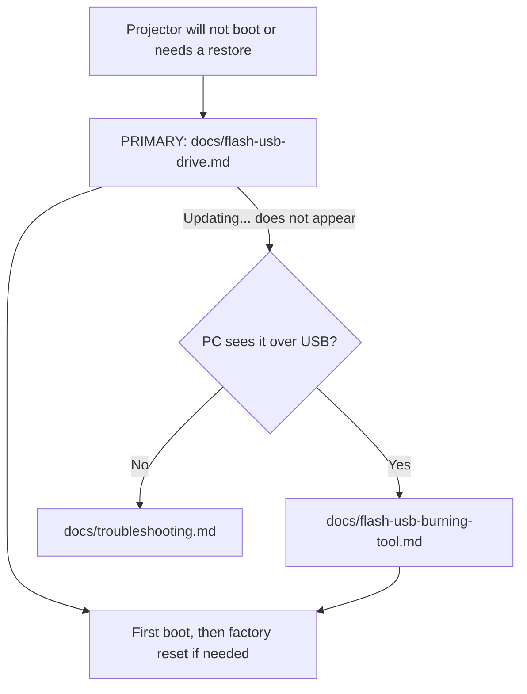

# 📽️ E-Gate Atom 3X: firmware restore kit

> Unofficial community kit for restoring the **E GATE Atom 3X** (model **E04i32**) Android projector from a boot loop or bad state. **Flashing erases the device. Follow the checks first. Not affiliated with E-Gate / Egate Infotel.**

## ⚡ At a glance

| Item | Value |
|---|---|
| Product | E GATE Atom 3X, model E04i32 (Egate Infotel Pvt Ltd, India) |
| SoC | Amlogic T950S |
| Board / device | `t950s_be311`, build board `ljs5` (`ap201`) |
| OS | Android 13 (`TQ2A.230405.003.E1`, userdebug, test-keys) |
| Package | `aml_upgrade_package.img` (2,233,291,152 bytes, about 2.08 GiB) |
| MD5 | `3efa401f3fe13a5e6b7fddd54ea299f3` |
| SHA256 | `111cec74c27d38b46a0d80c500d15dd979f2eccccce583e3e5003b3df6dd854d` |

## 🗺️ Which route do I take?



## 📦 Repository layout

```text
egate-atom-3x-firmware/
├── README.md                      this file
├── firmware/
│   ├── aml_sdc_burn.ini           SD-card burn script from the package
│   ├── md5.txt                    checksum shipped with the package
│   └── SHA256SUMS.txt             SHA256 computed for this repo
└── docs/
    ├── device-info.md             what the device reports about itself
    ├── flash-usb-drive.md         PRIMARY method: pendrive + power button
    ├── flash-usb-burning-tool.md  fallback: PC route
    └── troubleshooting.md         boot loop notes and what not to disable
```

> The `.img` is **not stored in git**. It is a [Release asset](#-getting-the-image).

## 📥 Getting the image

| Where | Status |
|---|---|
| Git history | ❌ Not stored: file is over GitHub's 100 MB limit |
| **[GitHub Release v1.0.0](https://github.com/AbdurRashidMondal/egate-atom-3x-firmware/releases/tag/v1.0.0)** | ✅ `aml_upgrade_package.img.7z` (898 MiB, 7-Zip compressed) |

| Step | Command |
|---|---|
| 1. Download | `aml_upgrade_package.img.7z` from the release page |
| 2. Check the archive | SHA256 `0b7d127a8621d241dcf18f77ffd9a99f4e711a3d3b89728a94e7bb808b496c62` |
| 3. Extract | `7z x aml_upgrade_package.img.7z` |
| 4. Check the image | MD5 and SHA256 below |

Always verify the extracted image before flashing:

```powershell
Get-FileHash .ml_upgrade_package.img -Algorithm MD5     # expect 3efa401f3fe13a5e6b7fddd54ea299f3
Get-FileHash .ml_upgrade_package.img -Algorithm SHA256  # expect 111cec74c27d38b46a0d80c500d15dd979f2eccccce583e3e5003b3df6dd854d
```

## ⚡ Primary install method

| # | Step |
|---|---|
| 1 | Copy **all** package files (`aml_upgrade_package.img`, `aml_sdc_burn.ini`, `md5.txt`) to the root of a FAT32 USB pendrive |
| 2 | Plug the pendrive into the projector |
| 3 | Turn the projector on |
| 4 | When the picture appears, **immediately press and hold the Power button again** |
| 5 | Keep holding until the screen shows **Updating...** |
| 6 | Wait for the restart. Do not cut power |

Full guide: [docs/flash-usb-drive.md](docs/flash-usb-drive.md)

## 🚨 Before you flash

| # | Check | Why |
|---|---|---|
| 1 | Your projector is **E04i32 / `t950s_be311`** | A wrong image can stop a board from starting at all |
| 2 | Checksums match | A damaged image can fail mid-flash |
| 3 | You accept that **all data is erased** | `aml_sdc_burn.ini` sets `erase_bootloader = 1` and `erase_flash = 1` |
| 4 | Power stays connected for the whole flash | An interrupted flash can leave the device unrecoverable |

## ⚖️ Legal and disclaimer

| Topic | Statement |
|---|---|
| Ownership | The firmware belongs to its original makers. This repo does not claim it |
| Warranty | None. You flash at your own risk |
| Docs licence | ⚠️ TODO: choose a licence for the docs only (for example MIT or CC BY 4.0) |
| Takedown | The maintainer will remove the image on a valid owner request |

## 🔗 References

| Source | Use |
|---|---|
| [Ugoos: Amlogic firmware upgrade guide](https://ugoos.com/firmware-upgrade-guide-for-amlogic-devices) | General Amlogic flashing |
| [androidtvbox.eu: flash an Amlogic box](https://androidtvbox.eu/how-to-flash-amlogic-tv-box/) | General Amlogic flashing |
| [XDA: t950s ROM thread](https://xdaforums.com/t/help-needed-with-t950s-armv7l-rom-firmware.4724793/) | Community discussion of this chip |
